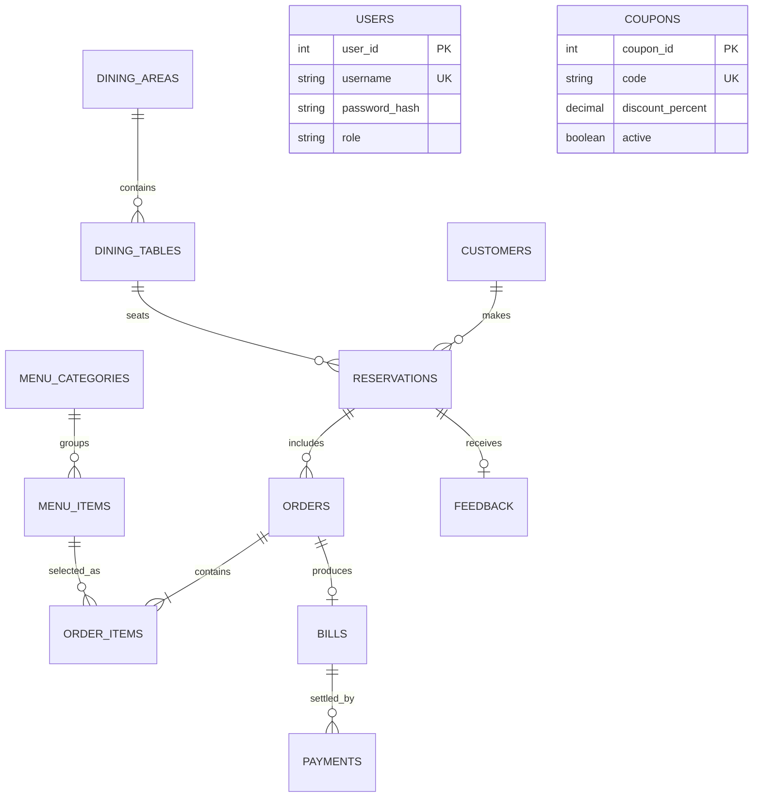

# Saffron & Ember

A demo-ready restaurant reservation, ordering, and billing application built for a Database Design & Management mini project. The interface is vanilla HTML, CSS, and JavaScript; the API is Node.js and Express; persistent data is stored in SQLite through `better-sqlite3`.

## Run locally

Requirements: Node.js 18 or newer and npm.

```sh
npm install
npm start
```

Open [http://localhost:3000](http://localhost:3000). The database is created and seeded automatically at `db/restaurant.sqlite` on first startup. The schema can also be read independently in [db/schema.sql](db/schema.sql); useful coursework queries are in [db/queries.sql](db/queries.sql).

Admin console: [http://localhost:3000/admin](http://localhost:3000/admin)

Demo credentials: `admin` / `admin123`. Change these before exposing the application to a network. To configure startup defaults, copy `.env.example` to `.env` and set `SESSION_SECRET`, `ADMIN_USERNAME`, `ADMIN_PASSWORD`, `PORT`, or `DB_PATH`. Never commit real credentials.

## Features

- Date, time, guest-count and dining-room selection with independent AC and Non-AC floor plans. Availability is refreshed every 15 seconds and rechecked in a transaction when a booking is submitted.
- A unique database constraint on `(table_id, reservation_date, time_slot)` is the final guard against double booking.
- Searchable, category-filtered menu with vegetarian filters, quantity controls, coupon validation, and reservation-linked orders.
- Itemized invoice with 5% GST, 5% service charge, a 10% AC surcharge, coupon discount, equal per-person estimate, QR code, and browser print / Save as PDF.
- Simulated cash, UPI, card, and net-banking payment outcomes. Cash change, transaction references, payment state, invoice reprint, bill history, and paid-visit feedback are persisted.
- English, Tamil, and Hindi dictionaries in `/i18n`, with an instant switcher and remembered preference. Menu category and dish names are translated too.
- Login-protected admin dashboard with daily KPIs, Chart.js revenue / room-usage / payment-mode charts, table and menu maintenance, customer edits, reservation updates, and daily-sales CSV export.
- Responsive customer and operations screens, loading feedback, form validation, print styles, and a remembered light / dark preference.

## Database design

`schema.sql` models customers, dining areas, dining tables, reservations, menu categories, menu items, orders, order items, bills, payments, admin users, coupons, and customer feedback. Tables use integer primary keys, foreign keys, uniqueness and domain checks, non-null requirements, and indexes on common search and join columns. `dining_tables` is named explicitly to avoid ambiguity with SQL's `TABLE` keyword while representing the requested `tables` entity.

The design follows 3NF for the modeled transactional data:

- **1NF:** each column stores one value; menu items and ordered items are rows rather than lists embedded in a reservation or order.
- **2NF:** each non-key attribute depends on its whole key. Junction data and quantities live in `order_items`, not on the order header.
- **3NF:** customer contact details, dining-area properties, category labels, and item prices are held in their owning entities. Reservations refer to customers and tables by key; orders refer to reservations; payments refer to bills.

`order_items.unit_price` intentionally snapshots the price at order time. Bill totals and fee components are also snapshots so historical invoices remain stable if menu prices or rates later change. SQLite triggers maintain the reservation's table status and calculate bill grand totals. The bill and its order lines are created in one database transaction; payment state and order state are changed together in another transaction. `available_tables_view` and `daily_sales_view` demonstrate reusable SQL views.

### ER diagram



## Schema notes

- Sample seed data includes 20 tables, 30 menu items, 10 customers, six menu categories, two dining areas, and two coupons.
- Reservation slots are `12:00 PM - 2:00 PM`, `2:00 PM - 4:00 PM`, `6:00 PM - 8:00 PM`, and `8:00 PM - 10:00 PM`.
- Coupon examples: `WELCOME10` and `FEAST20`.
- Currency is INR. The demo fee defaults are GST 5%, service charge 5%, and AC surcharge 10% of subtotal.
- The gateway is simulated; no card, UPI, or bank payment is sent. Card form values are not posted to the server.
- SQLite is the executable database. Its normalized relational types, keys, checks, and joins map directly to common MySQL types; adapt SQLite date functions, triggers, and auto-increment syntax when porting.

## Screenshots

Add screenshots here when capturing the app locally. Suggested captures: desktop home and table map, mobile menu and checkout, admin overview, and reservation management.

## Project layout

```text
public/       Customer site, styles, browser scripts, admin dashboard
routes/       Customer API and protected admin API
db/           SQLite initialization, schema, and coursework queries
i18n/         English, Tamil, and Hindi JSON dictionaries
server.js     Express setup and static/API routing
```